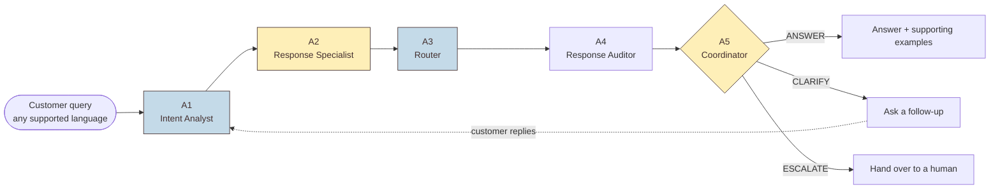
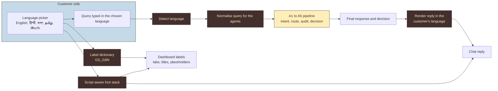

# Intelligent Customer Support & Automated Query Resolution

A coordinated multi-agent NLP system that understands a customer query, identifies its intent and category, retrieves relevant support guidance, drafts a response, and asks for clarification or escalates when it is unsure. The system started as the **Level 1 two-agent baseline** (A1, A2) and now runs **five coordinated agents** (A1 to A5), with multilingual support for English, Hindi and other Indian languages.

Dataset: [Bitext customer support](https://huggingface.co/datasets/bitext/Bitext-customer-support-llm-chatbot-training-dataset) (27 intents, 10 categories; fields `instruction`, `category`, `intent`, `response`, `flags`).

## Architecture

A customer first picks a store and a language, then asks a question. Five agents work on it one after the other, and the last one (A5) decides whether to answer, ask a follow-up, or hand the customer to a human.



### What each agent does

| Agent | Role | Receives | Produces |
|---|---|---|---|
| A1 Intent Analyst | Understand the query | Normalised customer query | Intent, category, confidence, top candidate intents |
| A2 Response Specialist | Draft guidance | A1 handoff (intent, category, confidence) | Draft response, similarity score, supporting examples from the train pool |
| A3 Router | Plan the next step | A1 and A2 outputs | Route, reason, signals (margin, evidence agreement), next steps |
| A4 Response Auditor | Check the draft | Draft response and predicted intent | Verdict, intent alignment, grounding score, issues, revision note |
| A5 Coordinator | Make the final call | All agent outputs and the escalation threshold | ANSWER, CLARIFY or ESCALATE, reason, final response |

The agents exchange information at every step: A1's intent, category and confidence go to A2, A3 uses both to choose a route, A4 audits the draft only when the route is a direct answer, and A5 combines everything into the final decision.

### Final decisions

- **ANSWER:** the audited response is shown together with the supporting examples it was built from.
- **CLARIFY:** the customer is asked a follow-up. Order, refund and invoice questions ask for an order number, email or phone (up to two asks); vague questions get one clarifying question. Each reply re-runs all five agents on everything said so far.
- **ESCALATE:** confidence is below the escalation threshold (adjustable in the UI, default 0.8), the query is out of scope, or the ask limit was reached. The customer sees human contact options for the chosen store.

### Components

| Component | File |
|---|---|
| A1 Intent Analyst | `support_agents/intent_classifier.py` |
| A2 Response Specialist | `support_agents/response_generator.py` |
| Coordination between A1 and A2 | `support_agents/multi_agent_system.py` |
| A3 Router, A4 Response Auditor, A5 Coordinator | `level1/agents_l2.py` |
| A1 to A2 pipeline with full trace | `level1/trace.py` |
| Data loading | `support_agents/data_loader.py` |
| Training | `support_agents/train_system.py` |
| Evaluation | `support_agents/evaluator.py` |
| Data inspection | `level1/inspect_data.py` |
| Trace generation | `level1/make_traces.py` |
| Demo stores | `level1/stores.py` |
| Landing dashboard | `level1/home.html` |
| Prototype UI (dashboard, chat, agent workings, history) | `level1/ui.py` |

## Multilingual support

Customers can use Grahak Seva in English, Hindi and several other Indian languages, so the support desk is reachable for people who are more comfortable outside English. The language layer sits around the five agents: the customer's query is normalised on the way in, the agents work as described above, and the final reply is shown in the customer's language on the way out.

<!-- Confirm the language list and how queries and replies are translated before submitting. -->



| Language | Script | Interface fonts |
|---|---|---|
| English | Latin | GS Body |
| Hindi | Devanagari | Kohinoor Devanagari, Noto Sans Devanagari |
| Bengali | Bengali | Kohinoor Bangla, Noto Sans Bengali |
| Tamil | Tamil | Kohinoor Tamil, Noto Sans Tamil |
| Telugu | Telugu | Kohinoor Telugu, Noto Sans Telugu |

What changes with the language:

- **Interface labels.** Fixed labels on the dashboard (the All, Answered, Clarify and Escalated tabs, section titles, placeholders and accessibility labels) are swapped from a label dictionary that `ui.py` passes to `home.html`. Any label without a translation falls back to English.
- **Fonts.** Each script has its own fallback fonts, so Devanagari, Bengali, Tamil and Telugu text renders correctly in the dashboard and the chat.
- **Agents.** A1 to A5 work on the normalised query, so intent prediction, routing, auditing and the ANSWER, CLARIFY and ESCALATE decisions are shared across all languages.

## Data and split

The organizer-provided `train.csv` and `validation.csv` are used exactly as given.

- **Train** fits the intent model and is the retrieval pool for supporting examples.
- **Validation** is held out. It is never used for training, retrieval or tuning, and only for reporting results.
- Full inspection (class balance, variation flags, duplicates, train/validation overlap) is in [`results/data_report.md`](results/data_report.md).

## How to run

```bash
pip install -r requirements.txt

python3 level1/inspect_data.py      # data report and split documentation
python3 support_agents/train_system.py   # train the baseline   (adjust if it takes arguments)
python3 support_agents/evaluator.py      # held-out evaluation  (adjust if it takes arguments)
python3 level1/make_traces.py       # writes results/traces.md
streamlit run level1/ui.py          # interactive prototype
```

## Results (validation set)

<!-- Fill these from results/metrics.json or the evaluator output. Do not estimate. -->

| Metric | Value |
|---|---|
| Intent Macro-F1 | `TODO` |
| Intent accuracy | `TODO` |
| Category accuracy | `TODO` |
| Validation rows evaluated | `TODO` |

Sample query-to-response outputs and five full agent traces are in [`results/traces.md`](results/traces.md).

## Example

"How can I request a refund for my purchase?" → A1 identifies a refund-related intent → A2 retrieves refund guidance and explains the steps, citing the supporting examples it used. See trace 1 in `results/traces.md`.

## Limitations

- The dataset is templated and synthetic, so scores on it are likely higher than on real customer traffic.
- The baseline retrieves or adapts existing reference responses; it does not yet verify its own answers beyond the A4 audit.
- Clarification is capped: one question for a vague query and up to two for missing order details, after which the customer is handed to a human.
- <!-- TODO: add anything you observe in results/error_analysis or the confusions table. -->

## Planned improvements

1. **Embedding retrieval** in place of lexical matching, to handle paraphrases and typos better.
2. **LLM-written, grounded responses** that cite the retrieved examples, with placeholders filled from the conversation.
3. **Confidence calibration**, so the clarify and escalate thresholds are tuned on data rather than set by hand.
4. **Richer multi-turn dialogue**, so the system can keep following up and re-classify with each new piece of information beyond the current ask limits.
5. **Near-duplicate-aware evaluation**, to measure generalisation to genuinely new wording.

## Team
Jackers: Jaya Mishra and Shivansh

<!-- Add names. -->
