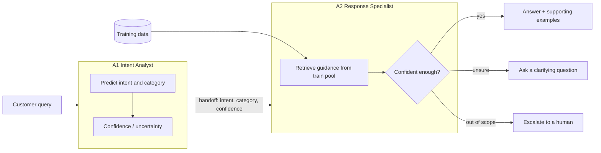

# Intelligent Customer Support & Automated Query Resolution

A coordinated multi-agent NLP system that understands a customer query, identifies its intent and category, retrieves relevant support guidance, drafts a response, and asks for clarification or escalates when it is unsure. This repository is the **Level 1 two-agent baseline**.

Dataset: [Bitext customer support](https://huggingface.co/datasets/bitext/Bitext-customer-support-llm-chatbot-training-dataset) (27 intents, 10 categories; fields `instruction`, `category`, `intent`, `response`, `flags`).

## Architecture



| Component | File |
|---|---|
| A1 Intent Analyst | `support_agents/intent_classifier.py` |
| A2 Response Specialist | `support_agents/response_generator.py` |
| Coordination between agents | `support_agents/multi_agent_system.py` |
| Data loading | `support_agents/data_loader.py` |
| Training | `support_agents/train_system.py` |
| Evaluation | `support_agents/evaluator.py` |
| Data inspection | `level1/inspect_data.py` |
| Trace generation | `level1/make_traces.py` |
| Prototype UI | `level1/ui.py` |

The agents exchange information: A1's predicted intent, category and confidence are passed to A2, which uses them to select guidance and to decide whether to answer, ask for clarification, or escalate.

## Data and split

The organizer-provided `train.csv` and `validation.csv` are used exactly as given.

- **Train** fits the intent model and is the retrieval pool for supporting examples.
- **Validation** is held out. It is never used for training, retrieval or tuning, and only for reporting results.
- Full inspection (class balance, variation flags, duplicates, train/validation overlap) is in [`results/data_report.md`](results/data_report.md).

## How to run

```bash
pip install -r requirements.txt

python3 level1/inspect_data.py      # data report and split documentation
python3 support_agents/train_system.py   # train the baseline   (adjust if it takes arguments)
python3 support_agents/evaluator.py      # held-out evaluation  (adjust if it takes arguments)
python3 level1/make_traces.py       # writes results/traces.md
streamlit run level1/ui.py          # interactive prototype
```

## Results (validation set)

<!-- Fill these from results/metrics.json or the evaluator output. Do not estimate. -->

| Metric | Value |
|---|---|
| Intent Macro-F1 | `TODO` |
| Intent accuracy | `TODO` |
| Category accuracy | `TODO` |
| Validation rows evaluated | `TODO` |

Sample query-to-response outputs and five full agent traces are in [`results/traces.md`](results/traces.md).

## Example

"How can I request a refund for my purchase?" → A1 identifies a refund-related intent → A2 retrieves refund guidance and explains the steps, citing the supporting examples it used. See trace 1 in `results/traces.md`.

## Limitations

- The dataset is templated and synthetic, so scores on it are likely higher than on real customer traffic.
- The baseline retrieves or adapts existing reference responses; it does not yet verify its own answers.
- Clarification is a single question, not a multi-turn dialogue.
- <!-- TODO: add anything you observe in results/error_analysis or the confusions table. -->

## Planned improvements

1. **Response-checker agent (A3):** verify that a drafted answer matches the predicted intent and does not invent policy, and send weak drafts back to A2.
2. **Embedding retrieval** in place of lexical matching, to handle paraphrases and typos better.
3. **LLM-written, grounded responses** that cite the retrieved examples, with placeholders filled from the conversation.
4. **Confidence calibration**, so the clarify and escalate thresholds are tuned on data rather than set by hand.
5. **Multi-turn clarification**, so the system asks a follow-up and re-classifies using the new information.
6. **Near-duplicate-aware evaluation**, to measure generalisation to genuinely new wording.

## Team

<!-- Add names. -->
